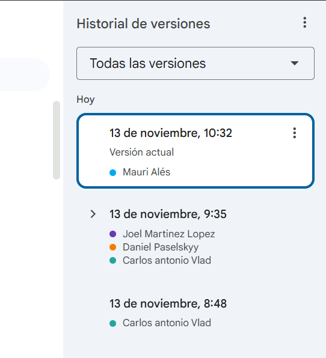

# UD4.1b · Comparativa de Suites Ofimáticas — Grupo 6 (Cliente B: La Clínica)

- **Asignatura:** Implantación de Aplicaciones Web (IAW · 2º ASIR · CIPFP Mislata)
- **Grupo:** 6
- **Suites comparadas:** ONLYOFFICE Docs vs Collabora Online
- **Cliente asignado:** Cliente B — Clínica, 15 empleados, guarda datos de salud.

---

## 1. Tabla comparativa (ONLYOFFICE Docs vs Collabora Online)

| Criterio | ONLYOFFICE Docs | Collabora Online |
|---|---|---|
| **Herramientas que incluye** | Procesador de textos, hojas de cálculo, presentaciones, creador de formularios rellenables, editor de PDF, libros electrónicos, visor de diagramas y herramientas de IA ✔ (web oficial). | Procesador de textos (text), hojas de cálculo (spreadsheets), presentaciones (presentations) y dibujo (drawings) ✔ (web oficial). |
| **SaaS, autoalojado o ambos** | Ambos: autoalojado en servidor propio y en la nube (SaaS), además de aplicaciones gratuitas de escritorio (Windows, Linux, macOS) y móviles (Android, iOS) ✔. | Ambos: autoalojado en infraestructura propia (on-premise) o como SaaS a través de proveedores de alojamiento asociados (hosting partners) ✔. |
| **Licencia** | Código abierto (AGPLv3) y versiones empresariales/comerciales (ONLYOFFICE Docs Enterprise y Developer) ✔. | Código abierto 100% auditable (MPLv2, Truly Open Source) con suscripciones de soporte empresarial ✔. |
| **¿Se edita a la vez?** | Sí: coedición en tiempo real, seguimiento del cursor del coautor, comentarios y control de cambios ✔. | Sí: visualización y edición colaborativa de documentos en equipo en tiempo real ✔. |
| **Dónde se guardan los datos** | En el servidor propio de la organización o en la plataforma conectada (mediante más de 50 conectores como Nextcloud), manteniendo el control total de los datos y el cumplimiento del RGPD (GDPR) ✔. | En la propia infraestructura de la organización ("Controlled by You") o en el servidor del socio de alojamiento elegido, garantizando la soberanía de los datos ✔. |
| **Un punto fuerte** | Compatibilidad píxel a píxel con Microsoft Office (más de 60 formatos), potente editor de PDF/formularios rellenables y herramientas de IA con anonimización (redacción) de datos sensibles ✔. | Código fuente totalmente auditable respaldado por una comunidad global, excelente compatibilidad con formatos ODF y Microsoft, y renderizado en servidor seguro ✔. |
| **Un punto débil** | Funciona como motor de edición, por lo que requiere integrarse con una plataforma de almacenamiento/colaboración externa o adquirir licencias comerciales para funciones avanzadas. | No incluye creador nativo de formularios PDF rellenables ni las herramientas de IA contextuales que incorpora ONLYOFFICE Docs, y también requiere integrarse con una plataforma de archivos. |

---

## 2. Tabla de precios

### ONLYOFFICE

| Modalidad | Plan | Precio | Capacidad / Límites | Características clave y encaje (Cliente B) |
|---|---|---|---|---|
| Nube (SaaS) | Startup | 0 € (Gratis) | Hasta 3 admins, 12 salas y 2 GB de almacenamiento | Usuarios/invitados ilimitados y soporte comunitario. No apto para la clínica porque los datos residen en la nube pública y solo tiene 2 GB. |
| Nube (SaaS) | Business | 20 € / admin / mes | Usuarios ilimitados y 250 GB por administrador | Incluye dominio propio, SSO (SAML/Google), auditoría y soporte profesional. Descartado para la clínica por externalizar datos de salud. |
| Autohospedado | Community (GitHub) | 0 € (AGPLv3) | Hasta ~20 conexiones simultáneas | **Opción ideal para el Cliente B:** se instala en el servidor de la clínica a coste 0 € manteniendo los datos médicos bajo control local. |
| Autohospedado | Home | 149 € / año (pago único/licencia) | Máximo 10 usuarios en 1 servidor | Uso doméstico/particular. Se queda corto para los 15 empleados de la clínica. |
| Autohospedado | Enterprise | Desde 33 € / conexión / año | Mínimo 50 conexiones (desde ~1.650 €/año) | Añade editores web móviles, panel de administración y soporte técnico oficial SLA. |
| Autohospedado | Developer | A medida | Mínimo 250 conexiones | Pensado para integradores que revenden el editor con marca blanca en su propio software. |

---

## 3. Recomendación para el Cliente B

Recomendamos implantar **ONLYOFFICE Docs autoalojado** en el servidor de la clínica (integrado con una plataforma privada como Nextcloud) para que los datos de salud nunca salgan de su infraestructura y cumplan estrictamente con el RGPD. Además de ofrecer a los 15 empleados compatibilidad píxel a píxel con Microsoft Office y coedición en tiempo real, incluye creación de formularios PDF rellenables y anonimización de datos sensibles, funciones ideales para gestionar consentimientos médicos y fichas de pacientes.

---

## 4. Captura del historial de versiones explicada

**Explicación del historial de versiones:** Hay cambios de todos los miembros del Grupo 6 trabajando de forma simultánea en un único documento compartido como editores, completando la tabla comparativa y la recomendación sin enviarnos versiones por correo.

---

## 5. Guía rápida para la exposición oral (3 minutos + 1 pregunta)

- **Integrante 1 (45 s) — Contexto y modelo de despliegue:** Presentación del Cliente B (clínica de 15 empleados con datos de salud) y explicación de por qué ambas suites deben desplegarse en modo autoalojado para mantener el control de los datos en el propio servidor.
- **Integrante 2 (45 s) — Herramientas, licencias y coedición:** Comparativa entre el código abierto auditable de Collabora Online (texto, hojas, presentaciones y dibujo) frente a las herramientas extra de ONLYOFFICE Docs (formularios rellenables, editor PDF e IA).
- **Integrante 3 (45 s) — Puntos fuertes y débiles:** Contraste entre la fidelidad píxel a píxel con Microsoft Office de ONLYOFFICE y la soberanía de código 100% libre de Collabora, señalando que ambas requieren integrarse con un gestor documental.
- **Integrante 4 (45 s) — Recomendación final para la clínica:** Justificación de la elección de ONLYOFFICE Docs autoalojado por sus formularios médicos rellenables en PDF, redacción de datos sensibles y cumplimiento del RGPD.
